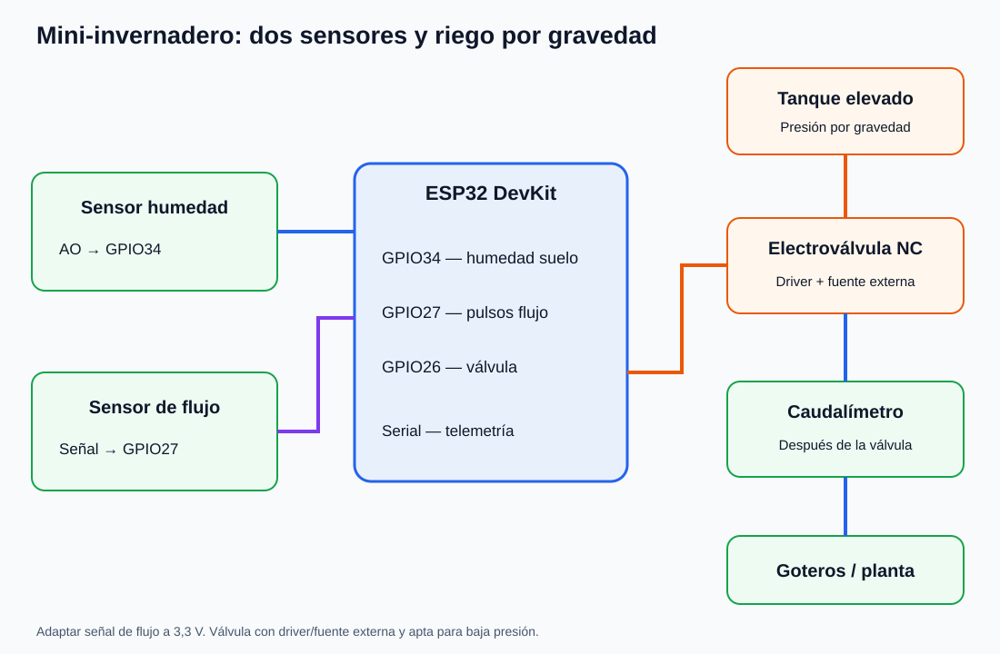

# Mini-Invernadero Inteligente

Sistema de monitoreo para un mini-invernadero. La documentación inicial identifica tres variables que se desean medir: temperatura y humedad relativa del aire, iluminación ambiental y humedad del suelo. Este repositorio incorpora una implementación de referencia para adquirir esas variables.

> **Importante sobre el alcance:** la información inicial no especificaba microcontrolador ni pinout. Para desarrollar el firmware y los diagramas se tomó como plataforma de referencia un **ESP32 DevKit V1 / ESP32-WROOM-32**. Esta elección es una propuesta técnica, no una confirmación de que sea la placa instalada en el prototipo. Verificarla antes de cablear. La bomba y el relé aparecen como opción de riego, porque no se confirmó que formen parte del montaje físico.

## 1. Integrantes

- Pendiente: agregar nombres completos y contribución de cada integrante.

## 2. Problema identificado

Las plantas de un invernadero requieren condiciones ambientales y humedad del sustrato adecuadas. Sin mediciones, el seguimiento depende de la observación manual. El proyecto busca instrumentar un mini-invernadero para obtener información de temperatura, luz y humedad del suelo y facilitar su supervisión.

## 3. Objetivos

### Objetivo general
Desarrollar un mini-invernadero inteligente que permita monitorear variables ambientales y del suelo mediante sensores electrónicos.

### Objetivos específicos
- Medir temperatura y humedad relativa del aire con un DHT22.
- Medir iluminación ambiental con un sensor BH1750.
- Medir humedad del sustrato con un sensor capacitivo.
- Integrar las lecturas en un microcontrolador y documentar su validación.
- Evaluar la incorporación de riego automático si el prototipo dispone de actuador y etapa de potencia.

## 4. Descripción del funcionamiento

1. El DHT22 proporciona temperatura del aire y humedad relativa.
2. El BH1750 mide iluminación ambiental en lux mediante el bus I²C.
3. El sensor capacitivo entrega una señal analógica relacionada con la humedad del suelo.
4. El ESP32 de referencia consulta los sensores y emite mediciones en formato JSON por el monitor serie.
5. De manera opcional, una salida del ESP32 puede controlar un módulo de relé para accionar una bomba con alimentación externa. Esta función está deshabilitada por defecto y requiere calibración y comprobación eléctrica previa.

## 5. Componentes

| Componente | Cantidad de referencia | Función / estado |
|---|---:|---|
| DHT22 | 1 | Temperatura y humedad relativa del aire; identificado en la información original |
| BH1750 | 1 | Iluminación ambiental; identificado en la información original (en el README inicial aparecía como BHL1750) |
| Sensor capacitivo de humedad del suelo | 1 | Humedad del sustrato; identificado en la información original |
| ESP32 DevKit V1 / ESP32-WROOM-32 | 1 | Microcontrolador elegido para la implementación de referencia; confirmar placa real |
| Módulo de relé | Opcional | Interfaz de potencia para riego; no confirmado en el montaje original |
| Bomba y fuente externa | Opcional | Actuador de riego; no confirmado en el montaje original |

Referencias de sensores consignadas en el README original:
- [DHT22 – Mactrónica](https://www.mactronica.com.co/sensor-de-temperatura-y-humedad-dht22)
- [BH1750 – Mactrónica](https://www.mactronica.com.co/sensor-de-luz-bhl1750-con-coraza)
- [Sensor capacitivo de humedad del suelo – Mactrónica](https://www.mactronica.com.co/sensor-de-humedad-del-suelo-capacitivo)

## 6. Arquitectura del sistema

**Entradas:** DHT22, BH1750 y sensor capacitivo.  
**Procesamiento:** ESP32 DevKit V1 como plataforma propuesta.  
**Salida de datos:** monitor serie a 115200 baudios, una línea JSON cada 2,5 segundos.  
**Riego:** salida de relé opcional; requiere bomba y fuente externa. Está deshabilitado inicialmente.

Consulta el diagrama editable en [diagramas/arquitectura.mmd](diagramas/arquitectura.mmd).

## 7. Diagrama de conexiones

| Módulo | Señal | Pin ESP32 propuesto |
|---|---|---|
| DHT22 | DATA | GPIO 4 |
| BH1750 | SDA | GPIO 21 |
| BH1750 | SCL | GPIO 22 |
| Sensor capacitivo | AO | GPIO 34 (ADC1) |
| Relé opcional | IN | GPIO 26 |

Alimentación, GND común y notas de seguridad están descritos en [diagramas/conexiones.md](diagramas/conexiones.md). Confirmar las tensiones admitidas por cada módulo; no aplicar 5 V a GPIO del ESP32 ni permitir que AO exceda el límite eléctrico de la placa.

## 8. Desarrollo del software

El firmware está en [codigo/mini_invernadero_esp32.ino](codigo/mini_invernadero_esp32.ino).

Funciones principales:
- Inicializa DHT22, BH1750 e interfaz I²C.
- Lee temperatura, humedad relativa, iluminación y ADC del sensor de suelo.
- Calcula un porcentaje de humedad de suelo a partir de dos puntos de calibración medidos.
- Publica los valores como JSON en el monitor serie.
- Incluye una lógica de riego opcional con histéresis, tiempo máximo de activación y tiempo mínimo de reposo.

Librerías Arduino IDE:
- DHT sensor library de Adafruit.
- Adafruit Unified Sensor.
- BH1750 (claws).

Instrucciones de instalación y carga: [codigo/README.md](codigo/README.md).

### Calibración del suelo

En el firmware, reemplazar `SOIL_DRY_RAW` y `SOIL_WET_RAW` con lecturas reales del sensor en sustrato seco y húmedo. No se asignaron valores de calibración inventados. Sin calibración, el porcentaje sale como `null` y el riego no puede activarse.

### Riego automático opcional

El firmware mantiene `ENABLE_IRRIGATION = false`. Sólo habilitarlo después de confirmar físicamente relé, bomba, fuente externa, polaridad del módulo, cableado y calibración. La bomba nunca se alimenta desde un GPIO o el pin 3V3 del ESP32.

## 9. Instalación y puesta en funcionamiento

1. Confirmar que la placa física sea ESP32 DevKit V1 / ESP32-WROOM-32 o adaptar el programa y diagrama.
2. Instalar Arduino IDE y el soporte para ESP32.
3. Instalar las librerías indicadas en `codigo/README.md`.
4. Cablear siguiendo [diagramas/conexiones.md](diagramas/conexiones.md), verificando primero alimentación y niveles lógicos.
5. Abrir y cargar `codigo/mini_invernadero_esp32.ino`.
6. Abrir el monitor serie a 115200 baudios y revisar que cada sensor entregue datos.
7. Calibrar el sensor de suelo con el sustrato utilizado.
8. Probar primero el monitoreo. No activar riego hasta validar el circuito de potencia y la bomba.

## 10. Pruebas de funcionamiento

**No se han aportado registros de pruebas físicas.** Los siguientes son casos de prueba propuestos, no resultados exitosos declarados.

| Prueba | Resultado esperado | Resultado obtenido | Estado |
|---|---|---|---|
| Lectura DHT22 | Obtener temperatura y humedad relativa | Pendiente de registrar | Pendiente |
| Lectura BH1750 | Obtener lecturas en lux y observar cambios con la luz | Pendiente de registrar | Pendiente |
| Lectura sensor capacitivo | Obtener lecturas ADC distintas entre sustrato seco y húmedo; calibrar porcentaje | Pendiente de registrar | Pendiente |
| Riego opcional | Activar y detener la bomba según umbrales calibrados | No verificado; función deshabilitada | Pendiente |

El procedimiento y el formato de registro están en [documentacion/calibracion-y-pruebas.md](documentacion/calibracion-y-pruebas.md). Cada prueba real debe documentarse con objetivo, procedimiento, resultado esperado, resultado obtenido, estado y evidencia.

## 11. Evidencias fotográficas

Agregar al menos cinco fotografías reales en `evidencias/fotos/`:
1. Componentes electrónicos.
2. Montaje y conexiones del circuito.
3. Proceso de construcción o ensamblaje.
4. Prototipo completo.
5. Prototipo durante una prueba real.

Las imágenes deben corresponder al proyecto del equipo; no sustituirlas por imágenes de referencia.

## 12. Video demostrativo

Pendiente incorporar un video real de 3 a 5 minutos con presentación del problema, componentes, conexiones, demostración de funcionamiento y resultados/dificultades. Guardarlo en `evidencias/videos/` o incluir un enlace accesible.

## 13. Dificultades y soluciones

Registrar al menos dos dificultades que hayan ocurrido realmente, indicando síntoma, causa, solución intentada y resultado. No se han suministrado incidencias concretas.

## 14. Conclusiones y estado actual

La información original identifica los sensores DHT22, BH1750 y capacitivo para humedad del suelo. Se añadió un firmware de referencia ESP32, pinout, diagrama y procedimiento de calibración. La placa ESP32 es una decisión de implementación que se debe confirmar contra el prototipo. El firmware todavía requiere carga y validación física; tampoco hay evidencias de pruebas, fotografías ni video en los materiales disponibles.

## 15. Contribuciones y créditos

Cada integrante debe indicar su aporte. Reconocer librerías, diseños y recursos de terceros. No publicar contraseñas Wi-Fi, tokens ni credenciales.

## Estructura del repositorio

~~~text
.
├── README.md
├── codigo/
│   ├── mini_invernadero_esp32.ino
│   └── README.md
├── diagramas/
│   ├── arquitectura.mmd
│   ├── conexiones.md
│   └── conexiones_esp32.svg
├── evidencias/
│   ├── fotos/
│   └── videos/
├── pruebas/
└── documentacion/
    └── calibracion-y-pruebas.md
~~~
