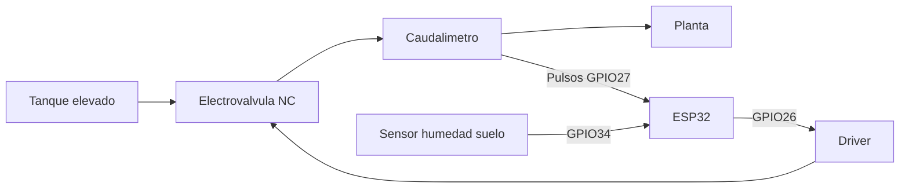

# Conexiones — ESP32 y riego por gravedad

## Únicos dos sensores

| Elemento | Conexión | Nota |
|---|---|---|
| Sensor capacitivo suelo | AO → GPIO34; VCC/GND según ficha | AO dentro del rango ADC del ESP32 |
| Caudalímetro | señal → GPIO27; VCC/GND según modelo | Adaptar salida a 3,3 V; respetar flecha de flujo |

## Actuador

GPIO26 → entrada de driver/relé → electroválvula normalmente cerrada. Alimentar válvula con fuente externa dimensionada para su tensión y corriente. Incorporar protección de transitorios según fabricante. Nunca alimentar la válvula desde un GPIO.

## Hidráulica

Tanque elevado → electroválvula NC → caudalímetro → manguera/goteros → planta. El sensor de flujo queda después de la válvula. Verificar que la electroválvula funcione con la presión estática disponible: algunas válvulas piloto requieren presión mínima. Verificar también el caudal mínimo del caudalímetro.

## Diagrama lógico

No aplicar 5 V a GPIO del ESP32. Compartir referencia GND de señal cuando el circuito lo requiera. Mantener electrónica protegida de salpicaduras.
